<div align="center">

# PDF2Obsidian

**把论文 PDF 变成 Obsidian 里可读、可检索、可链接的中文笔记。**

本地优先 · 解析 + 翻译 + 阅读材料 + 元数据 + 双链，一次完成


[快速开始](#快速开始) · [界面预览](#界面预览) · [工作原理](#工作原理) · [配置说明](#配置说明) · [文档](#文档)

</div>

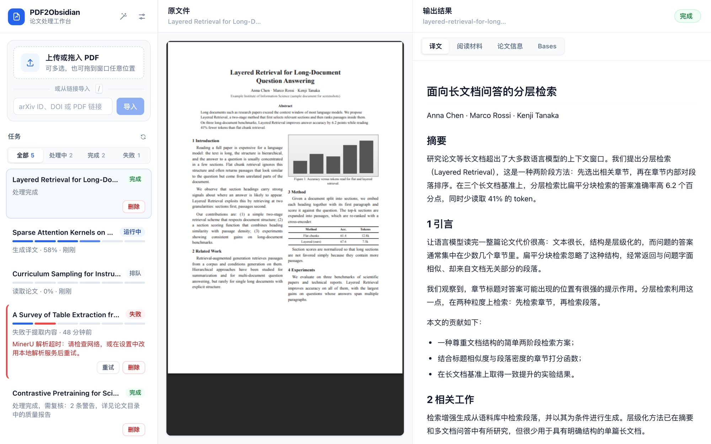

PDF2Obsidian 是一个 local-first 的开源论文处理工具，用于把 PDF 转换为适合 Obsidian 阅读、检索和沉淀的 Markdown 知识库内容。

它面向个人研究、论文精读、技术调研和知识管理场景，核心流程包括 PDF 解析、Markdown 规范化、论文元数据补全、全文翻译、阅读材料生成、自动双链、质量检查和 Obsidian 导出。

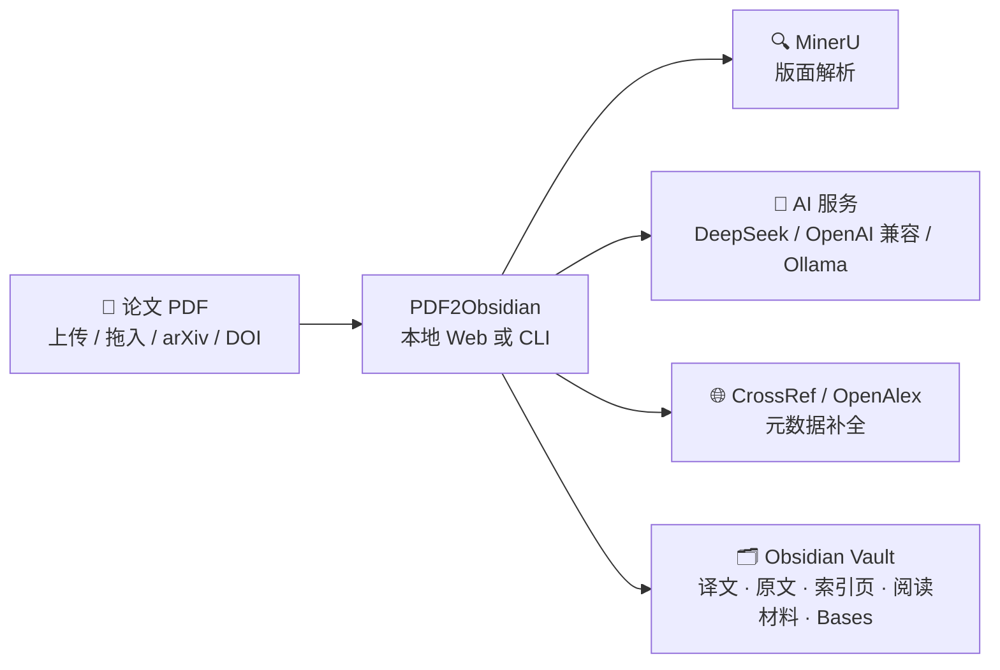

## 特性

| | 能力 | 说明 |
| --- | --- | --- |
| 📥 | PDF 导入 | 单篇、批量、目录监听；Web 端支持多选、拖到窗口任意位置，或粘贴 arXiv ID / DOI / PDF 链接 |
| 🔍 | MinerU 解析 | 本地服务、远程服务或官方 API 三种模式，保留标题、段落、图片、表格、代码块和公式 |
| 🌏 | 中文译文 | DeepSeek、Cloudflare、OpenAI、OpenRouter 等 OpenAI 兼容服务或本地 Ollama，带重试和缓存 |
| 📝 | 阅读材料 | 自动生成摘要、术语表和问答，方便精读和复习 |
| 🏷️ | 元数据补全 | 从正文抽取论文信息，可通过 CrossRef、OpenAlex、EasyScholar 补全期刊与分区 |
| 🔗 | 自动双链 | 扫描已有 Vault 内容，为正文中的概念建立 WikiLink |
| 🗃️ | Obsidian 导出 | 译文、原文、索引页、图片资源和 Bases 数据库 |
| ✅ | 质量报告 | 检查缺失图片、元数据和阅读材料，写入 `report.json` |
| 🖥️ | 本地 Web 工作台 | 配置向导、任务队列、PDF 预览与结果预览，支持暗色模式和快捷键 |
| ⌨️ | CLI 工作流 | 适合脚本化处理、批量导入和长期监听 inbox 目录 |

## 界面预览

> 截图使用虚构的示例论文和任务数据。

<table>
  <tr>
    <td width="50%">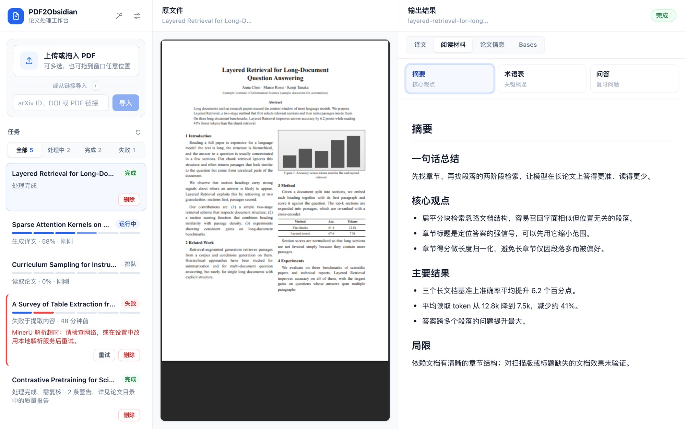<br><sub><b>阅读材料</b>：摘要 / 术语表 / 问答，一键切换</sub></td>
    <td width="50%">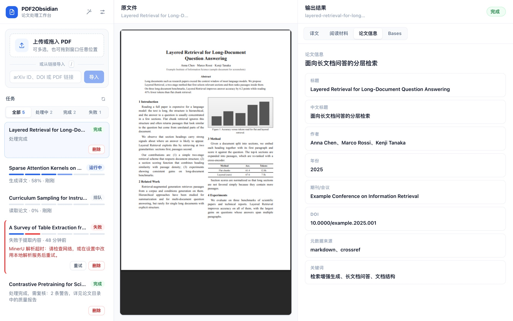<br><sub><b>论文信息</b>：标题、作者、DOI、来源与关键词</sub></td>
  </tr>
  <tr>
    <td>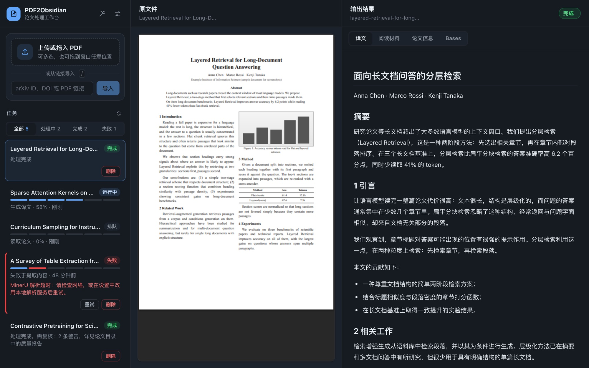<br><sub><b>暗色模式</b>：跟随系统自动切换</sub></td>
    <td>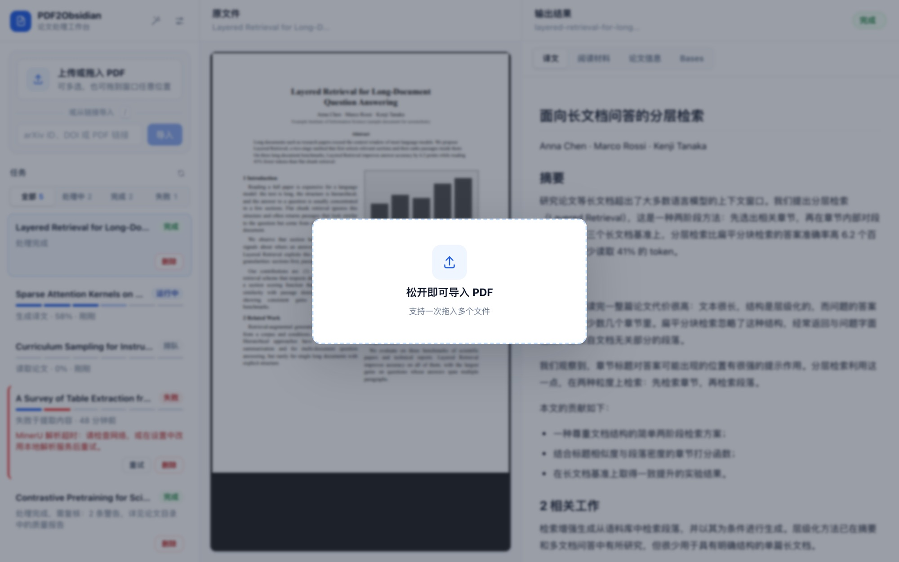<br><sub><b>拖入导入</b>：把 PDF 拖到窗口任意位置，可一次多个</sub></td>
  </tr>
  <tr>
    <td>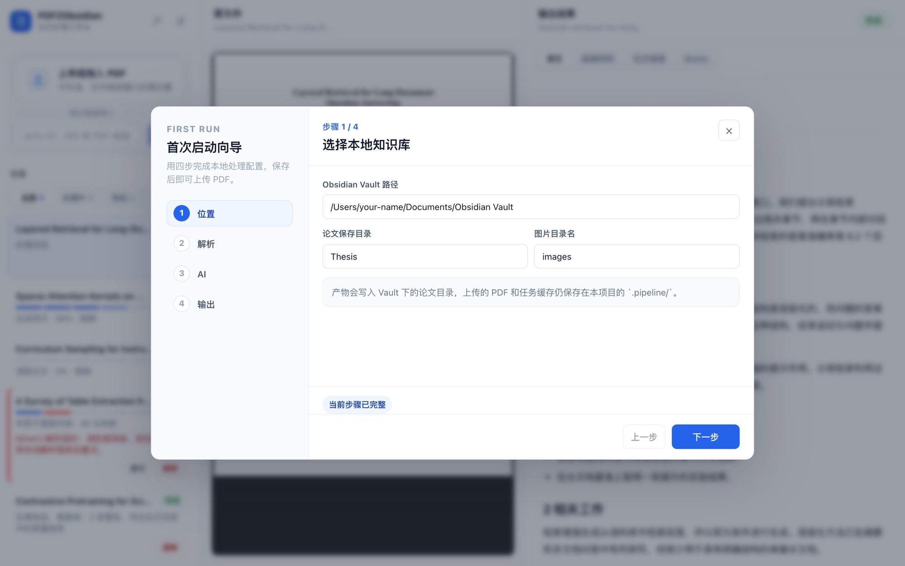<br><sub><b>首次启动向导</b>：位置 → 解析 → AI → 输出四步完成配置</sub></td>
    <td>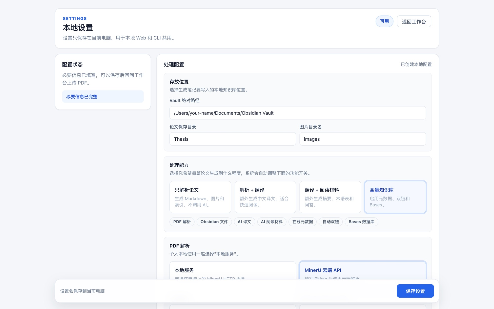<br><sub><b>本地设置</b>：按处理能力一键切换功能组合</sub></td>
  </tr>
</table>

## 系统要求

- Node.js >= 20.0.0
- pnpm 10.x
- MinerU 运行环境 / MinerU 官方 API
- 可选：DeepSeek API Key
- 可选：Ollama 本地模型服务
- 可选：EasyScholar API Key
- 一个本地 Obsidian Vault 目录

## 快速开始

**1. 安装依赖**

```bash
pnpm install
```

**2. 复制配置模板**

```bash
cp pdf2obsidian.config.example.yaml pdf2obsidian.config.yaml
```

**3. 编辑配置**（至少填写 Vault 路径；也可以跳过这步，启动 Web 后用首次启动向导填写）

```yaml
vault:
  # macOS 示例；Windows 写成 C:\Users\your-name\Documents\Obsidian Vault
  path: /Users/your-name/Documents/Obsidian Vault
  # Vault 内存放论文的目录
  documentDir: Thesis
  # 图片资源目录名
  imageDirName: images
```

**4. 启动本地 Web 工作台**，打开 <http://localhost:3000>

```bash
pnpm dev:oss
```

**或者用命令行导入单篇论文**

```bash
pnpm dev:cli import paper.pdf
```

## 本地 Web 工作台

本地 Web 用于个人桌面工作流。它会读取根目录的 `pdf2obsidian.config.yaml`，也支持通过环境变量指定配置文件：

```bash
PDF2OBSIDIAN_CONFIG=/path/to/pdf2obsidian.config.yaml pnpm dev:oss
```

页面分为三栏：

| 左栏 | 中栏 | 右栏 |
| --- | --- | --- |
| 上传 / 拖入 / 链接导入，任务列表按 全部 · 处理中 · 完成 · 失败 筛选，每个任务显示各阶段进度，失败可重试 | 原 PDF 预览；配置未完成时显示配置引导 | 译文、阅读材料（摘要 / 术语表 / 问答）、论文信息、Bases |

快捷键：

| 按键 | 作用 |
| --- | --- |
| `/` | 聚焦链接输入框 |
| `↑` / `↓` | 在当前筛选的任务之间切换 |
| `Esc` | 退出输入框 |

本地 Web 的上传文件默认放在 `.pipeline/desktop-web/uploads`，任务索引放在 `.pipeline/desktop-web/tasks/tasks.json`（与 CLI 的任务记录相互独立）。

## CLI 用法

导入单篇 PDF：

```bash
pnpm dev:cli import paper.pdf
```

指定配置文件：

```bash
pnpm dev:cli import paper.pdf --config ./pdf2obsidian.config.yaml
```

批量导入：

```bash
pnpm dev:cli batch paper1.pdf paper2.pdf
```

批量导入并限制并发：

```bash
pnpm dev:cli batch paper1.pdf paper2.pdf --concurrency 2
```

监听 inbox 目录：

```bash
pnpm dev:cli watch .pipeline/inbox
```

查看任务：

```bash
pnpm dev:cli tasks list
```

查看任务详情：

```bash
pnpm dev:cli tasks show <taskId>
```

重试任务：

```bash
pnpm dev:cli tasks retry <taskId>
```

## 配置说明

配置文件默认是：

```text
pdf2obsidian.config.yaml
```

可以从模板复制：

```text
pdf2obsidian.config.example.yaml
```

### Vault

```yaml
vault:
  path: /Users/your-name/Documents/Obsidian Vault
  documentDir: Thesis
  imageDirName: images
```

- `path`：Obsidian Vault 绝对路径。
- `documentDir`：论文产物写入的目录。
- `imageDirName`：图片资源目录名。

### MinerU

```yaml
mineru:
  command: ./.venv-mineru/bin/mineru
  outputDir: .pipeline/mineru
  mode: official
  backend: pipeline
  apiUrl: http://127.0.0.1:30000
  method: txt
  modelSource: modelscope
  modelVersion: vlm
  apiTokenEnv: MINERU_OFFICIAL_API_TOKEN
  formula: false
  table: false
  imageAnalysis: false
```

常用字段：

- `mode`：解析模式，`official` 使用 MinerU 官方 API，`local` 连接 `apiUrl` 上的 MinerU HTTP 服务，`cli` 直接运行本地 `command`。
- `backend`：解析后端，`pipeline`（常规）或 `vlm-http-client`（VLM 高精度）。
- `apiUrl`：本地或远程 MinerU 服务地址（`mode` 为 `local` 时生效）。
- `command`：本地 MinerU 命令路径（`mode` 为 `cli` 时生效）。
- `method`：解析方案，`auto`、`txt` 或 `ocr`。
- `modelVersion`：官方 API 云端模型版本，`vlm`（高精度）或 `pipeline`（常规），仅 `mode` 为 `official` 时生效。
- `apiTokenEnv`：官方 API Token 或环境变量名，仅 `mode` 为 `official` 时生效。
- `formula`、`table`、`imageAnalysis`：公式、表格和图片分析开关。

### 翻译

```yaml
translation:
  enabled: true
  provider: openai-compatible
  preset: deepseek
  model: deepseek-v4-flash
  baseUrl: https://api.deepseek.com
  apiKeyEnv: DEEPSEEK_API_KEY
  chunkCharLimit: 24000
  cacheDir: .pipeline/core-cache
  maxRetries: 3
  systemPrompt: '你是专业技术文档译者...'
```

- `enabled`：是否启用正文翻译，设为 `false` 可跳过翻译步骤。
- `provider`：模型调用协议，支持 `openai-compatible` 或 `ollama`。
- `preset`：OpenAI 兼容服务预设，支持 `deepseek`、`cloudflare`、`openai`、`openrouter` 或 `custom`。
- `systemPrompt`：自定义翻译提示词，按需修改。

DeepSeek、Cloudflare Workers AI、OpenAI 和 OpenRouter 共用 OpenAI 兼容客户端，只需配置对应的模型、Base URL 和 API Key。旧配置中的 `provider: deepseek` 会自动迁移。

Cloudflare Workers AI 示例：

```yaml
translation:
  enabled: true
  provider: openai-compatible
  preset: cloudflare
  model: "@cf/qwen/qwen3-30b-a3b-fp8"
  baseUrl: https://api.cloudflare.com/client/v4/accounts/<ACCOUNT_ID>/ai/v1
  apiKeyEnv: CLOUDFLARE_API_TOKEN
```

如果使用 DeepSeek，推荐通过环境变量提供密钥：

```bash
export DEEPSEEK_API_KEY=sk-...
```

如果使用 Ollama，`baseUrl` 通常是：

```text
http://127.0.0.1:11434
```

### 任务管理

```yaml
tasks:
  stateDir: .pipeline/tasks
  inboxDir: .pipeline/inbox
  concurrency: 3
  watchPollIntervalMs: 5000
```

- `stateDir`：任务状态持久化目录。
- `inboxDir`：`watch` 模式的监听目录，新 PDF 放入即自动处理。
- `concurrency`：批量处理最大并发数。
- `watchPollIntervalMs`：`watch` 模式轮询间隔（毫秒）。

### 阅读材料

```yaml
readingAssets:
  enabled: true
  summaryFileName: 摘要.md
  termsFileName: 术语表.md
  qaFileName: 问答.md
  maxSourceChars: 50000
  maxRetries: 3
  systemPrompt: '你是严谨的论文阅读助手...'
```

- `enabled`：是否生成阅读材料。
- `systemPrompt`：自定义阅读材料提示词，按需修改。

启用后会额外生成摘要、术语表和问答，这些内容会调用已配置的 AI 服务。

### 质量检查

```yaml
quality:
  reportFileName: report.json
```

- `reportFileName`：质量报告文件名，写入论文目录。

### 元数据

```yaml
metadata:
  enrichFromMarkdown: true
  online:
    enabled: true
    providers:
      - crossref
      - openalex
    email: your-email@example.com
  journalMetrics:
    sqlite:
      path: .pipeline/journal-metrics.sqlite
    easyScholar:
      enabled: true
      baseUrl: https://www.easyscholar.cc/open/getPublicationRank
      secretKeyEnv: EASYSCHOLAR_SECRET_KEY
  overrides: {}
```

- `enrichFromMarkdown`：从 Markdown 正文启发式提取标题、作者、年份、DOI 等。
- `online`：通过 CrossRef 和 OpenAlex API 在线补全元数据（默认关闭，上例为开启写法）。
- `journalMetrics`：期刊指标补全（影响因子、JCR 分区、中科院分区等），通过 EasyScholar API 查询并缓存到本地 SQLite（`easyScholar.enabled` 默认关闭，需要 SecretKey）。
- `overrides`：按论文 slug 手动覆盖元数据字段。

### Obsidian

```yaml
obsidian:
  autoLink:
    enabled: true
    scanDirs: []
    excludeDirs:
      - .obsidian
      - .trash
    minAliasLength: 4
    maxLinksPerNote: 30
  database:
    enabled: true
    fileName: 数据库.base
```

`autoLink` 会扫描 Vault 中已有笔记，自动为正文中的已知概念创建 WikiLink。

`database` 会生成 Obsidian Bases 数据库文件。

## 工作原理

### 处理流水线

每篇 PDF 依次经过六个阶段，Web 任务卡片上的进度条就对应这六段：

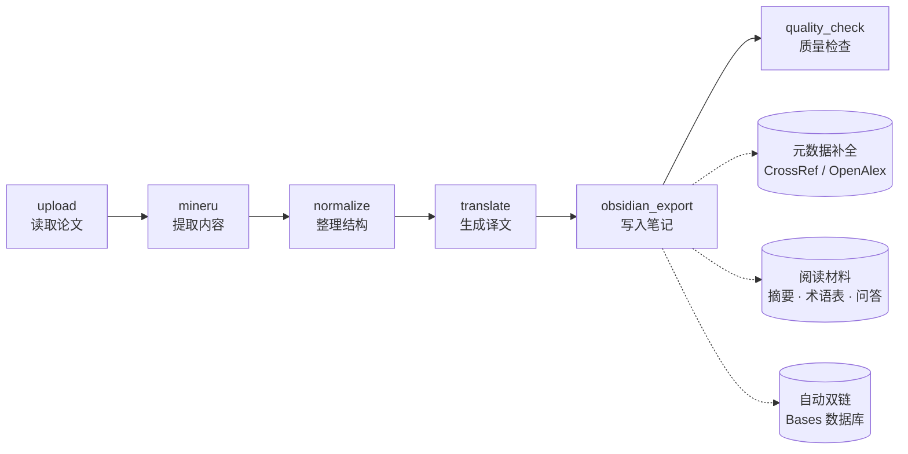

- `upload`：读取输入 PDF，计算文件哈希。
- `mineru`：调用 MinerU 解析 PDF。
- `normalize`：整理 Markdown、图片路径和论文基础信息。
- `translate`：按块翻译正文，或在中文文档 / 关闭翻译时跳过。
- `obsidian_export`：写入 Vault，生成索引和相关 Markdown 文件。
- `quality_check`：检查产物质量并写出报告。

元数据补全、自动双链和阅读材料在译文生成后、写入笔记前完成。翻译、阅读材料和在线元数据都有本地缓存；任务失败后重试会跳过已完成的阶段，其余步骤依靠缓存避免重复调用付费接口。

## 输出产物

一次成功导入通常会生成：

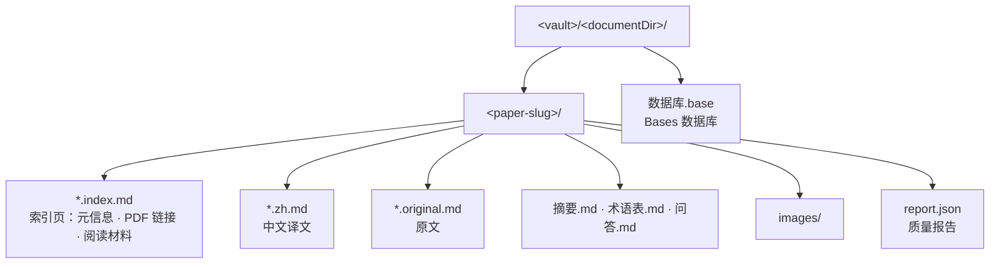

```text
<vault>/<documentDir>/<paper-slug>/
  <paper-slug>.zh.md
  <paper-slug>.index.md
  <paper-slug>.original.md
  摘要.md
  术语表.md
  问答.md
  report.json
  images/
```

如果启用 Bases，还会生成：

```text
<vault>/<documentDir>/数据库.base
```

产物说明：

- `*.zh.md`：中文译文或中文原文。
- `*.index.md`：论文索引页，包含元信息、PDF 链接、阅读材料和自动关联。
- `*.original.md`：原文 Markdown。
- `摘要.md`：核心观点摘要。
- `术语表.md`：关键术语和上下文解释。
- `问答.md`：面向复习的问题与答案。
- `report.json`：质量检查报告。
- `images/`：从 PDF 中提取并改写链接后的图片资源。

## Monorepo 结构

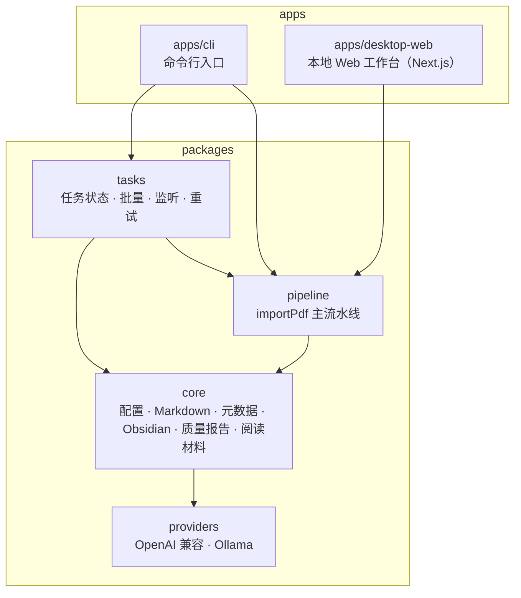

```text
apps/
  cli/             # 命令行入口
  desktop-web/     # 本地 Web 工作台

packages/
  core/            # 配置、Markdown、元数据、Obsidian、质量报告、阅读材料、存储和工具
  providers/       # DeepSeek、Ollama 等 Provider
  pipeline/        # PDF 导入主流水线
  tasks/           # 任务状态、批量执行、监听导入、重试和任务事件协议

docs/              # 项目文档
```

## 开发命令

构建共享包：

```bash
pnpm build:packages
```

启动 CLI 开发命令：

```bash
pnpm dev:cli --help
```

启动本地 Web：

```bash
pnpm dev:oss
```

构建 CLI：

```bash
pnpm build:cli
```

构建本地 Web：

```bash
pnpm build:oss
```

## 数据与缓存目录

默认运行过程中会产生以下本地目录或文件：

```text
.pipeline/
  mineru/
  tasks/
  inbox/
  downloads/
  core-cache/          # 翻译与在线元数据缓存
  core-assets-cache/   # 阅读材料缓存
  journal-metrics.sqlite
  desktop-web/         # uploads/、downloads/、tasks/tasks.json
```

配置中的相对路径按配置文件所在目录解析，所以默认都在配置文件旁的 `.pipeline/` 下。

这些目录用于解析中间产物、任务状态、缓存和本地上传文件。它们不应该提交到 Git。

## 常见问题

### 配置文件找不到

确认当前目录存在：

```text
pdf2obsidian.config.yaml
```

或者通过 `--config` / `PDF2OBSIDIAN_CONFIG` 指定路径。

### DeepSeek 报 API Key 错误

检查配置中的 `translation.apiKeyEnv`，并确认环境变量已设置：

```bash
echo $DEEPSEEK_API_KEY
```

### Ollama 无法连接

确认 Ollama 服务已启动，并且 `translation.baseUrl` 指向正确地址：

```text
http://127.0.0.1:11434
```

### 元数据补全失败

可以先关闭在线补全：

```yaml
metadata:
  online:
    enabled: false
```

也可以检查网络、CrossRef/OpenAlex 请求限制和 `metadata.online.email`。

### Obsidian 中图片不显示

检查：

- `vault.path` 是否正确。
- `vault.documentDir` 是否在目标 Vault 内。
- `vault.imageDirName` 是否与产物中的图片路径一致。
- MinerU 是否成功提取图片。

## 文档

- [技术文档索引](docs/zh/README.md)（[English](docs/en/README.md)）：系统设计、安装配置与使用指南、术语表、PDF 导入流水线专题。
- 编码代理（Claude Code、Codex 等）从 [AGENTS.md](AGENTS.md) 开始阅读。

## 致谢

感谢 [MinerU](https://github.com/opendatalab/MinerU) 和 [EasyScholar](https://www.easyscholar.cc/) 为本项目提供免费的 API 服务支持。

## License

本项目基于 [MIT License](LICENSE) 开源。
