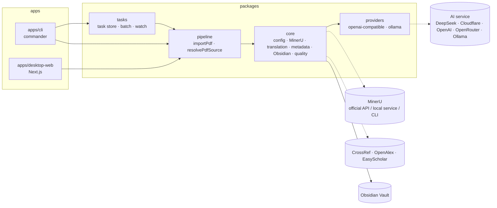

# PDF2Obsidian · System Architecture and Detailed Design

中文：[系统架构与详细设计](../zh/system-design.md)

This document describes PDF2Obsidian as it is now: its packages, how config is loaded, how one PDF becomes Obsidian notes, how tasks are persisted, the local web API, and where data lives. Step-by-step stage details are in [PDF Import Pipeline](topics/pdf-import-pipeline.md).

## 1. Introduction

### 1.1 Purpose

PDF2Obsidian is a local-first paper-processing tool. It parses a paper PDF into Markdown, enriches the paper's metadata, translates it into Simplified Chinese, generates a summary, glossary and Q&A, and writes an index note, translated note, original note and a Bases database into a local Obsidian Vault.

Two ways to use it:

- **Local web workbench** (`apps/desktop-web`): visual config, upload or import by link, preview of the original PDF and the outputs.
- **CLI** (`apps/cli`): single import, batch import, watching an inbox directory, listing and retrying tasks.

### 1.2 Design principles

1. **One pipeline.** Both CLI and web call `importPdf` in `packages/pipeline`; apps only handle input, task state and display.
2. **Local first.** Outputs go only to the local Vault. External services (MinerU official API, AI service, CrossRef / OpenAlex, EasyScholar) are each behind a config switch and can be combined into a fully local setup (local MinerU + Ollama + online metadata off).
3. **Cache what can be cached.** Translation, reading assets, online metadata and journal metrics are cached locally; CLI tasks are reused by content hash so quota is not spent twice.
4. **Resumable.** Each stage's state is persisted; a retry after failure skips completed stages.
5. **Config validated in one place.** Defaults and validation are defined once, in the zod schema used by `loadConfig`.

## 2. Architecture

### 2.1 Components



### 2.2 Tech stack

| Layer | Choice |
| --- | --- |
| Language and runtime | TypeScript (ESM, strict), Node.js >= 20 |
| Package manager | pnpm 10 workspace (`apps/*`, `packages/*`) |
| Config | YAML (`yaml`) + zod 4 validation |
| PDF parsing | MinerU (official API `mineru.net`, HTTP service or local CLI); result archives unpacked with `fflate` |
| LLM calls | Own OpenAI-compatible and Ollama clients (`packages/providers`), no vendor SDK |
| CLI | `commander`, run with `tsx` in development |
| Local web | Next.js 15 App Router, React 19, plain CSS |

### 2.3 Packages and dependency direction

Dependencies go one way: `providers` ← `core` ← `pipeline` ← `tasks` ← apps. Each package compiles with `tsc` to `dist/`, and apps import the compiled output, so run `pnpm build:packages` after changing a package (the `dev:cli` and `dev:oss` scripts do this automatically).

| Package | Responsibility |
| --- | --- |
| `@pdf2obsidian/providers` | Text-generation client interface `TextGenerationClient.generateText({ systemPrompt, userPrompt })`, created per `provider` |
| `@pdf2obsidian/core` | Config; MinerU calls; Markdown chunking and translation; metadata extraction, online enrichment, journal metrics and citation formats; reading assets; auto-links, reference stubs, note export, Bases; quality report; utilities |
| `@pdf2obsidian/pipeline` | The six-stage `importPdf`; `resolvePdfSource` turns a local path / arXiv id / DOI / PDF URL into a local PDF |
| `@pdf2obsidian/tasks` | CLI task store, batch pool, retry, inbox watch, and the event wrapper `runCoreImportTask` |

## 3. Configuration

### 3.1 Sources and loading

- A single config file `pdf2obsidian.config.yaml` (not committed); template `pdf2obsidian.config.example.yaml`.
- CLI: `--config`, default `pdf2obsidian.config.yaml` in the current working directory.
- Web: env var `PDF2OBSIDIAN_CONFIG` first, else `pdf2obsidian.config.yaml` in the workspace root (found by walking up to `pnpm-workspace.yaml`); when the file is missing the template is used as a form draft.
- Top-level sections: `vault`, `mineru`, `translation`, `tasks`, `readingAssets`, `quality`, `obsidian`, `metadata`. Common keys: [user guide §3](user-guide.md#3-configuration).

### 3.2 Validation and defaults

`loadConfig()` (`packages/core/src/config/load-config.ts`) parses YAML and runs the zod schema, which fills defaults, validates enums and types, and normalises a few values:

- `vault.documentDir` loses drive letters, UNC prefixes and leading/trailing slashes so it is a path inside the Vault; empty becomes `Thesis`.
- `mineru.apiUrl` without a scheme gets `https://`.
- With `translation.enabled` true and `provider` not `ollama`, `apiKeyEnv` or `apiKey` is required.

### 3.3 Migration

The legacy `translation.provider: deepseek` is turned into `provider: openai-compatible` + `preset: deepseek` on load; the web's `normalizeConfigData` does the same before saving and filters `metadata.online.providers` to the supported `crossref` / `openalex`.

### 3.4 Web save and pre-flight checks

- Save: form data is written to a temp file `.pipeline/desktop-web/config-<uuid>.yaml` and validated with `loadConfig`; only then is the real config overwritten. Validation errors are formatted as Chinese "field: reason" messages. Saving rewrites the YAML; existing comments are lost.
- Pre-flight `validateLocalRuntimeConfig` runs before each task: MinerU token env var (`official` mode), whether `apiUrl` / `baseUrl` are valid URLs, leftover placeholders, `baseUrl` wrongly ending in `/chat/completions`, the Cloudflare URL shape, and whether the key env var is set. The AI service is still checked when translation is off but reading assets are on.

## 4. Import pipeline (packages/pipeline)

### 4.1 Entry point and stages

`importPdf({ pdfPath, config, onStep, completedSteps })` runs six stages and reports each through `onStep` as `running / completed / failed / skipped`:

| Stage | Does |
| --- | --- |
| `upload` | Check the path is a file, compute SHA-256 (`sourceHash`) |
| `mineru` | Copy the PDF to `<mineru.outputDir>/<runId>/document.pdf`, call MinerU, delete the copy |
| `normalize` | Find the primary Markdown, derive `slug` from its first heading, wipe and rebuild `<vault>/<documentDir>/<slug>/`, copy images |
| `translate` | Detect language; skip for Chinese or when disabled, otherwise translate in chunks |
| `obsidian_export` | Write `*.original.md`, `*.zh.md`, `*.index.md`, copy the PDF, extract references and create stub notes |
| `quality_check` | Write `report.json` |

Between `translate` and `obsidian_export`, enrichment steps that are not named stages run: reference-alias discovery and auto-linking, metadata extraction and online enrichment, reading-asset generation. After all stages the Bases file is rewritten and `import-result.json` is written to the MinerU output dir. Step details, caches and resume behaviour: [PDF Import Pipeline](topics/pdf-import-pipeline.md).

### 4.2 MinerU modes

`runMineru` (`packages/core/src/storage/mineru-runner.ts`) routes by `mineru.mode`:

| `mode` | Behaviour |
| --- | --- |
| `official` (default) | `mineru.net` batch API: request upload URL, upload, poll, download and unzip; the whole call is retried once. Model version from `modelVersion` |
| `local` + `apiUrl` | Multipart POST to `<apiUrl>/tasks` (`backend`, `parse_method`, formula / table / image-analysis switches). If the configured localhost is unreachable, other local addresses (e.g. WSL) are tried |
| `cli` (or `local` without `apiUrl`) | Spawn `mineru.command` with `-p -o -b [-m -f -t --image-analysis]`; `local` also passes `--api-url` (from `MINERU_MANAGED_API_URL` or `apiUrl`) |

### 4.3 Translation and AI service

- `chunkMarkdown` splits along headings into chunks of at most `translation.chunkCharLimit` characters; each chunk's user message carries the document title, heading path and chunk number to reduce term drift.
- Each chunk checks the cache first; misses call the model and retry up to `maxRetries` with linear back-off.
- `provider: openai-compatible` serves DeepSeek, Cloudflare Workers AI, OpenAI, OpenRouter and custom services (`preset` is only a label and drives the form); `provider: ollama` calls a local Ollama.
- Reading assets reuse the translation AI service config with their own prompt and cache dir.

### 4.4 Quality report

`report.json` has `status` `completed` or `needs_review`. Warnings come from heading or image count mismatches, missing image files, missing or invalid frontmatter, and metadata / reading-asset warnings. `metrics` records chunk count, cache hits, auto-link count, metadata field count and sources, etc. The status is only in the report; it does not affect task status.

## 5. Task management (packages/tasks, CLI)

### 5.1 Task store

- One dir per task: `<tasks.stateDir>/<taskId>/state.yaml`, holding a `PipelineTaskState` (§8.3).
- `taskId` = `<yyyyMMddHHmmss>-<file-name slug>-<hash chars 7–18>`.
- `createOrReuseTask`: if a non-failed task with the same `sourceHash` exists, return it instead of processing again.

### 5.2 Batch and concurrency

`runPdfBatch` creates or reuses a task per PDF and runs only `queued` ones; `runTaskPool` is a shared-cursor pool sized by `--concurrency` or `tasks.concurrency`. A failure marks only that task `failed`.

### 5.3 Inbox watch

`watchPdfInbox` scans `tasks.inboxDir` (or the command argument) recursively every `watchPollIntervalMs` ms; submitted paths are remembered in memory, and a `running` flag prevents overlapping rounds. After a restart everything is scanned again, but finished PDFs are skipped by hash reuse.

### 5.4 Retry and resume

`retryPipelineTask` accepts only `queued` / `failed` tasks. `resetTaskForRetry` keeps `completed` / `skipped` stages and resets the rest to `pending`; `getCompletedSteps` passes the kept stages as `completedSteps` to `importPdf`, which skips them.

## 6. Local web workbench (apps/desktop-web)

### 6.1 Pages

| Path | Component | Content |
| --- | --- | --- |
| `/` | `LocalWorkspace` | Left: upload PDF, import by link (arXiv / DOI / URL), task list (all / running / done / failed), delete and retry. Middle: original PDF preview. Right: translation, reading assets (summary / glossary / Q&A), paper info, Bases |
| `/` dialog | `OnboardingWizard` | First-run wizard: location → parsing → AI → output. Opens automatically when config is missing or invalid and the user has not completed or dismissed it (kept in browser `localStorage`) |
| `/settings` | `SettingsWorkspace` | Advanced settings: form for the whole config |

The task list polls `/api/tasks` every 1.8 s.

### 6.2 Local task queue

`lib/local-tasks.ts` has its own task queue, separate from the CLI:

- Tasks live in an in-process `Map`, written to `.pipeline/desktop-web/tasks/tasks.json` (under the workspace root) on every change.
- Uploads are saved as `.pipeline/desktop-web/uploads/<taskId>-<file name>`; link imports download to `.pipeline/desktop-web/downloads/` and are moved into the upload dir.
- A task starts as soon as it is created; there is no concurrency limit and no reuse by hash.
- Progress is estimated per stage (at most 96 %, 100 % on completion); at most 240 log lines are kept.
- Retry keeps completed / skipped stages; running or queued tasks cannot be deleted or retried; deleting removes the uploaded PDF but not the notes in the Vault.

### 6.3 Error diagnosis

`lib/error-diagnostics.ts` maps common errors (Cloudflare URL, OpenAI-compatible 404 / 401 / 403, MinerU token missing, MinerU service unreachable, AI key missing, …) to a Chinese summary and suggestions, stored in the task's `error` and log.

## 7. API contract

The web API is for the local page only. All routes run in the Node.js runtime and return JSON (except the PDF route).

| Method and path | Request | Response |
| --- | --- | --- |
| `GET /api/config` | — | `{ raw, data, path, exists, valid, error? }` |
| `POST /api/config` | `{ data }` (form object) or `{ raw }` (YAML text) | Same; HTTP 400 with `valid: false` on validation failure |
| `GET /api/tasks` | — | `{ tasks: LocalTask[] }`, newest first |
| `POST /api/tasks` | `multipart/form-data` with field `file` (`.pdf`), or JSON `{ url }` (arXiv id / DOI / PDF URL) | `201 { task }`; errors `400 { error }` |
| `GET /api/tasks/:id` | — | `{ task }`; 404 if missing |
| `POST /api/tasks/:id` | `{ action: "retry" }` | `{ task }`; 400 if not retryable |
| `DELETE /api/tasks/:id` | — | `{ ok: true }`; 400 while running |
| `GET /api/tasks/:id/pdf` | — | The original PDF, `Content-Type: application/pdf`, inline |
| `GET /api/tasks/:id/artifact?kind=` | `kind` ∈ `original`, `translated`, `index`, `database`, `summary`, `terms`, `qa` | `{ path, content }`; 404 with a Chinese explanation if not generated |

## 8. Data and storage

### 8.1 Local directories

| Path | Content | Written by |
| --- | --- | --- |
| `<mineru.outputDir>/<runId>/` | MinerU output (Markdown, images, JSON), `import-result.json` | pipeline |
| `translation.cacheDir` | One `<sha256>.md` per translated chunk | core/translation |
| `readingAssets.cacheDir` | One `<sha256>.md` per reading asset | core/reading |
| `metadata.online.cacheDir` | `<provider>-<hash>.json` | core/metadata |
| `metadata.journalMetrics.sqlite.path` | Journal metrics SQLite cache | core/metadata |
| `tasks.stateDir/<taskId>/state.yaml` | CLI task state | tasks |
| `.pipeline/downloads/` | CLI link-import downloads | cli |
| `.pipeline/desktop-web/` | Web uploads, downloads, task index `tasks/tasks.json`, config temp files | desktop-web |

Defaults are in [user guide §7](user-guide.md#7-data-and-cache-directories); relative paths resolve against the process cwd (see §9).

### 8.2 Vault output

```text
<vault>/<documentDir>/
  <slug>/
    <slug>.index.md       # index note: links, metadata, auto-links
    <slug>.zh.md          # translation (original text for Chinese docs or when translation is off)
    <slug>.original.md    # original Markdown
    <original file name>.pdf
    摘要.md  术语表.md  问答.md   # reading assets (names configurable)
    report.json           # quality report
    images/               # images (dir name configurable)
  <reference stub>.md     # stub notes for structured references
  数据库.base             # Bases database (filter type == "index")
```

All three notes carry YAML frontmatter: `title`, paper metadata (`authors`, `year`, `journal`, `doi`, `impactFactor`, `jcrQuartile`, `casQuartile`, …), `lang`, `sourceHash`, wiki-links to each other, `createdAt`, translation provider and model, `translationSkipped`; the index note also has `type: index`.

### 8.3 Task data model

**CLI `PipelineTaskState`** (`state.yaml`): `taskId`, `sourcePath`, `sourceHash`, `status` (`queued | running | completed | failed | skipped`), `createdAt` / `updatedAt` / `startedAt` / `finishedAt`, `slug`, `result` (`ImportPdfResult`), `error`, `steps` (per stage `{ status, startedAt, completedAt, error }`).

**Web `LocalTask`** (element of the `tasks.json` array): `id`, `fileName`, `pdfPath`, `status` (`queued | running | completed | failed`), `progress` (0–100), time fields, `error`, `result`, `steps` (`[{ step, status, message, updatedAt }]`), `logs`.

**`ImportPdfResult`**: `sourceHash`, `slug`, `originalNotePath`, `translatedNotePath`, `indexNotePath`, `databaseNotePath?`, `configSummary` (MinerU mode and backend, translation on/skipped, provider and model, reading assets on).

## 9. Known issues and doc/code differences

Differences found while checking the code for this document, recorded as they are; rewrite the entry when fixed.

| # | Observation | Code |
| --- | --- | --- |
| 1 | `pnpm dev:cli` and `pnpm dev:oss` run via `pnpm --filter` inside `apps/cli` and `apps/desktop-web`. The CLI's default `--config`, relative PDF paths, and relative dirs in config (`.pipeline/...`) for both apps resolve against that sub-directory, while the web's uploads and task index are in the workspace-root `.pipeline/`. The README's `pnpm dev:cli import paper.pdf` is only reliable with absolute paths | `apps/cli/src/cli/main.ts`, `apps/desktop-web/lib/paths.ts` |
| 2 | CLI `import` calls `resolve()` on the input before detecting its type, so bare arXiv ids (e.g. `2401.12345`) and DOIs become local paths; `https://` URLs are fine | `apps/cli/src/cli/main.ts` |
| 3 | The README says the task index is in `.pipeline/tasks`; the web actually writes `.pipeline/desktop-web/tasks/tasks.json`, and `.pipeline/tasks` is only the default CLI `tasks.stateDir`. The two task lists don't see each other | `lib/local-tasks.ts`, `packages/tasks` |
| 4 | Cache dir defaults: code uses `.pipeline/core-cache` (translation, online metadata) and `.pipeline/core-assets-cache` (reading assets); the template and README use `translation-cache`, `metadata-cache`, `reading-assets-cache` | `load-config.ts`, `pdf2obsidian.config.example.yaml` |
| 5 | `metadata.online.enabled` and `easyScholar.enabled` default to `false` in code but are `true` in the template | same |
| 6 | The README says `*.original.md` is "only generated when the original needs to be kept"; the pipeline currently always writes it | `import-pdf.ts`, `export-notes.ts` |
| 7 | The README describes `mode: local` as "connect to a local service"; code also has a `cli` mode, and `local` without `apiUrl` goes to the CLI and requires `MINERU_MANAGED_API_URL` | `mineru-runner.ts` |
| 8 | Two PDFs whose first heading yields the same `slug`: the later import wipes and overwrites the earlier paper folder | `import-pdf.ts` (normalize) |
| 9 | If the process exits while a web task runs, that task stays `running` in `tasks.json` and cannot be deleted or retried from the UI | `lib/local-tasks.ts` |
| 10 | On resume, metadata enrichment, auto-linking and reading assets run again (caches avoid repeat calls); `needs_review` in `report.json` is not reflected in task status | `import-pdf.ts` |
| 11 | A reading-asset model call that still fails after retries throws and fails the whole import; since it is not a named stage, CLI tasks record the failure under `translate`. The code comment intends reading-asset failures not to block the main export | `generate-reading-assets.ts`, `import-pdf.ts` |
