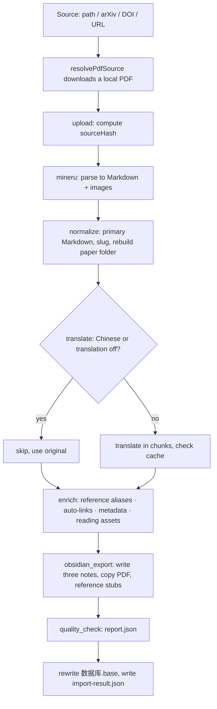

# PDF Import Pipeline: From PDF to Obsidian Notes

Status: current state. 中文：[PDF 导入流水线](../../zh/topics/pdf-import-pipeline.md)

This document follows the code in execution order: how one PDF goes from input to the Vault, and for each step its caches, what it writes to the Vault and its known risks. Code: `packages/pipeline/src/import-pdf.ts` (pipeline), `packages/pipeline/src/resolve-pdf-source.ts` (source resolution), `packages/core/src/**` (step implementations). Overview: [system design §4](../system-design.md#4-import-pipeline-packagespipeline).

---

## 1. Source resolution

`resolvePdfSource(input, outputDir, baseDir?)` decides the input type:

- Input starting with `http(s)://`, shaped like `arXiv:2401.12345` / `2401.12345`, or starting with `10.xxxx/` is remote and downloaded to `outputDir`; anything else is a local file.
- arXiv ids download from `arxiv.org`; DOIs resolve through `doi.org`; URLs are downloaded directly.
- Local relative paths resolve against the caller's `baseDir` (the CLI passes the invocation dir). Callers must pass the raw input so the type is detected before any path resolution.
- The CLI downloads to `.pipeline/downloads/` next to the config file; the web downloads to `.pipeline/desktop-web/downloads/` and moves the file into the upload dir.

## 2. upload

Check the path is a file and compute its SHA-256 as `sourceHash`. From it:

- `runId` = first 15 chars of the file-name slug + `-` + first 16 chars of the hash; the parse dir is `<mineru.outputDir>/<runId>/`.
- The CLI `taskId` and task reuse are also based on this hash (see [system design §5](../system-design.md#5-task-management-packagestasks-cli)).

## 3. mineru

1. Copy the PDF to `<parse dir>/document.pdf` (so special characters in the file name don't affect MinerU); the copy is deleted afterwards.
2. Call the official API, HTTP service or local command according to `mineru.mode` ([system design §4.2](../system-design.md#42-mineru-modes)).
3. The official API returns a zip, which is downloaded and unpacked into the parse dir.

Cache: the parse dir itself. On resume, a completed `mineru` stage is not re-run; the existing output is read. Changing how `runId` is built makes every paper parse again.

## 4. normalize

1. `findPrimaryMarkdown` finds the primary Markdown in the parse dir (preferring a file named `document`).
2. The first heading is the original title (else the file name); `toSlug` derives the base slug. `resolveUniqueSlug` reads `sourceHash` from `<documentDir>/<base slug>/<base slug>.index.md`: if the folder or index note is missing or the hash matches, the base slug is used; if it belongs to another paper, `<base slug>-<first 8 hash chars>` is used.
3. Paper folder `documentRoot` = `<vault.path>/<vault.documentDir>/<slug>/`. **The folder is deleted first**, recreated, and MinerU's `images/` is copied to `<documentRoot>/<imageDirName>/`.
4. `rewriteMarkdownAssetLinks` rewrites image links to Vault paths.

On resume, deletion and copying are skipped, but the primary Markdown is read and the slug recomputed (later steps need them).

Risk: re-importing the same paper deletes files the user added inside its paper folder.

## 5. translate

1. `detectMarkdownLanguage` strips frontmatter, code, links, URLs, digits and punctuation, then counts Han and Latin letters: ≥ 120 Han with a high enough ratio → `zh-CN`; ≥ 120 Latin with Han ratio < 8 % → `en`; otherwise `unknown`.
2. For `zh-CN` or `translation.enabled: false`, translation is skipped and the translated note uses the original.
3. Otherwise `translateMarkdownInChunks`:
   - `chunkMarkdown` first splits into semantic sections by heading (keeping the heading path), then splits long sections and merges small ones, each at most `chunkCharLimit`.
   - Cache key per chunk = sha256(provider, preset, baseUrl, model, systemPrompt, chunk content); cache file `<translation.cacheDir>/<key>.md`.
   - On a miss it sends the system prompt plus a user message (document title, current heading path, chunk number, instructions, chunk content); failures retry up to `maxRetries`, waiting 1 s, 2 s, …
   - Translated chunks are joined with blank lines.
4. On resume with `translate` completed, the existing `<slug>.zh.md` minus its frontmatter is used as the translation.

Cache: changing the model, service URL or prompt re-translates every chunk; so does changing the chunking rules or the user-message format (the latter is not in the cache key but changes the output — decide whether to clear the cache when changing it).

## 6. Enrichment steps between stages

These are not named stages and run on every run, including resumes:

| Step | Does | Key config |
| --- | --- | --- |
| Reference-alias discovery | Find linkable aliases from original + translation and existing Vault notes; the count goes into the index note | `obsidian.autoLink` |
| Auto-link | Scan the Vault (`scanDirs`, minus `excludeDirs`) for titles and aliases and replace mentions in the translation with `[[target\|text]]`; skip frontmatter, code blocks, headings, existing links and images; the paper's own notes and reading assets are not targets; at most `maxLinksPerNote` per note | `minAliasLength`, `maxLinksPerNote` |
| Metadata | Text extraction → CrossRef / OpenAlex fill empty fields in turn (a failing source only adds a warning; low title similarity counts as a false hit and an empty result is cached) → local journal-metrics DB → EasyScholar → apply `overrides` by slug or PDF file name | `metadata.*` |
| Reading assets | Take half of `maxSourceChars` from the original and half from the translation (head and tail when longer), generate summary, glossary and Q&A with the reading-asset prompt; add frontmatter and a link back to the index note; write straight into the paper folder | `readingAssets.*` |

Reading-asset cache key = sha256(the four AI-service fields, `readingAssets.systemPrompt`, `sourceHash`, asset kind, asset prompt). Content problems such as a missing index-link placeholder are warnings; if an asset's model call still fails after retries, that asset is skipped (no file, no link in the index note), the reason goes into the quality report as a warning, and the import continues.

## 7. obsidian_export

1. Build three notes, each with frontmatter (paper metadata, `lang`, `sourceHash`, links to each other, `createdAt`, translation provider and model, `translationSkipped`):
   - `<slug>.original.md`: original Markdown (links rewritten).
   - `<slug>.zh.md`: auto-linked translation.
   - `<slug>.index.md`: title; links to original / translation / PDF / reading assets; language detection; metadata list; auto-link list; `type: index`.
2. Copy the original PDF into the paper folder.
3. `extractStructuredReferences` finds numbered references (`[1]`, `1.`, `1)`, …) in original + translation and extracts title, authors, year, DOI, arXiv id and journal; `createReferenceStubs` creates stub notes under `<vault>/<documentDir>/` for entries with no same-title note in the Vault and skips the rest.

## 8. quality_check and wrap-up

1. `createQualityReport` compares heading and image counts between original and translation, checks that image files exist and frontmatter is valid, collects metadata and reading-asset warnings, and writes `<documentRoot>/<quality.reportFileName>`. Any warning gives `status: needs_review`; the status and warning count go into the result as `qualityStatus` / `qualityWarningCount` (read from the existing report when the stage is skipped on resume).
2. After all stages (regardless of resume), `exportObsidianDatabase` rewrites `<documentDir>/<database.fileName>`, filtering notes with `type == "index"` inside `documentDir` and listing name, title, authors, year, journal, citations, impact factor, JCR, CAS quartile, DOI, APA and BibTeX citations.
3. `import-result.json` (`sourceHash`, `slug`, `databaseNotePath`) is written to the parse dir and `ImportPdfResult` is returned.

## 9. Resume behaviour summary

| Stage | On resume |
| --- | --- |
| `upload` | Always runs (hash recomputed) |
| `mineru` | Skipped if completed; existing parse dir is read |
| `normalize` | If completed, deletion and image copy are skipped; slug is still recomputed |
| `translate` | If completed, translation is restored from the existing `*.zh.md` |
| Enrichment steps | Always run, relying on their caches |
| `obsidian_export` | Skipped if completed (no notes or stubs written) |
| `quality_check` | Skipped if completed |
| Bases and `import-result.json` | Always run |
