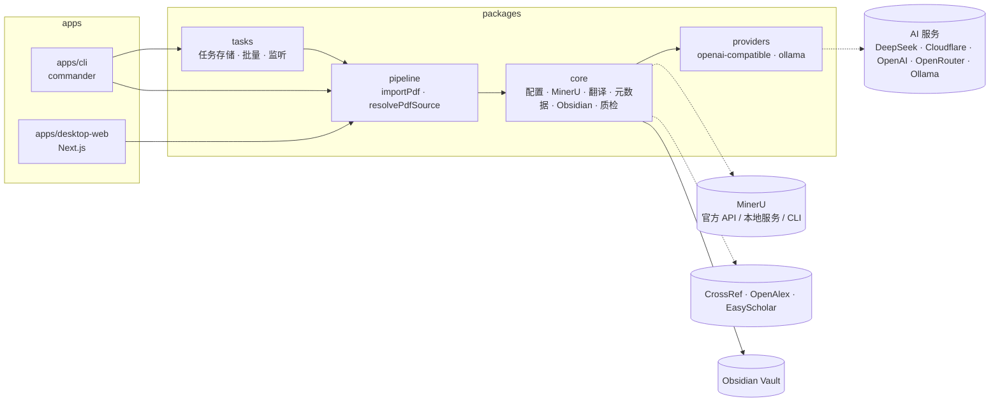

# PDF2Obsidian · 系统架构与详细设计

English: [System Architecture and Detailed Design](../en/system-design.md)

本文说明 PDF2Obsidian 现在的结构：由哪些包组成、配置怎么加载、一篇 PDF 如何变成 Obsidian 笔记、任务如何持久化、本地 Web 提供哪些接口，以及数据放在哪里。阶段内部的逐步细节见 [PDF 导入流水线](topics/pdf-import-pipeline.md)。

## 1. 引言

### 1.1 定位

PDF2Obsidian 是 local-first 的论文处理工具：把论文 PDF 解析为 Markdown，补全论文元数据，翻译为简体中文，生成摘要、术语表和问答，再以索引页、译文、原文和 Bases 数据库的形式写入本地 Obsidian Vault。

使用方式有两种：

- **本地 Web 工作台**（`apps/desktop-web`）：可视化配置、上传或按链接导入、预览原 PDF 与产物。
- **命令行**（`apps/cli`）：单篇导入、批量导入、监听 inbox 目录、查看与重试任务。

### 1.2 设计原则

1. **一条流水线。** CLI 与 Web 都调用 `packages/pipeline` 的 `importPdf`；应用层只负责输入、任务状态与展示。
2. **本地优先。** 产物只写入本地 Vault；外部服务（MinerU 官方 API、AI 服务、CrossRef / OpenAlex、EasyScholar）都由配置开关控制，可组合成完全本地运行（MinerU 本地服务 + Ollama + 关闭在线元数据）。
3. **能缓存就缓存。** 翻译、阅读材料、在线元数据、期刊指标都有本地缓存；同一 PDF 的命令行任务按内容哈希复用，避免重复消耗额度。
4. **可续跑。** 每个阶段的状态被持久化，失败后重试会跳过已完成的阶段。
5. **配置集中校验。** 默认值与校验只在 `loadConfig` 的 zod 模式中定义一次。

## 2. 总体架构

### 2.1 组成



### 2.2 技术栈

| 层 | 选型 |
| --- | --- |
| 语言与运行时 | TypeScript（ESM、strict），Node.js >= 20 |
| 包管理 | pnpm 10 workspace（`apps/*`、`packages/*`） |
| 配置 | YAML（`yaml`）+ zod 4 校验 |
| PDF 解析 | MinerU（官方 API `mineru.net`、HTTP 服务或本地 CLI），结果包用 `fflate` 解压 |
| 大模型调用 | 自带的 OpenAI 兼容客户端与 Ollama 客户端（`packages/providers`），不依赖官方 SDK |
| 命令行 | `commander`，开发时用 `tsx` 直接运行 |
| 本地 Web | Next.js 15 App Router、React 19、原生 CSS |

### 2.3 包与依赖方向

依赖只能单向：`providers` ← `core` ← `pipeline` ← `tasks` ← 应用。各包用 `tsc` 编译到 `dist/`，应用引用编译产物，所以改包后要先 `pnpm build:packages`（`dev:cli`、`dev:oss` 脚本会自动执行）。

| 包 | 职责 |
| --- | --- |
| `@pdf2obsidian/providers` | 文本生成客户端接口 `TextGenerationClient.generateText({ systemPrompt, userPrompt })`，按 `provider` 创建 |
| `@pdf2obsidian/core` | 配置；MinerU 调用；Markdown 分块与翻译；元数据抽取、在线补全、期刊指标与引用格式；阅读材料；自动双链、参考文献桩、笔记导出、Bases；质量报告；工具函数 |
| `@pdf2obsidian/pipeline` | `importPdf` 六阶段流水线；`resolvePdfSource` 把本地路径 / arXiv ID / DOI / PDF URL 变成本地 PDF |
| `@pdf2obsidian/tasks` | 命令行用的任务状态存储、批量任务池、重试、inbox 监听，以及事件化包装 `runCoreImportTask` |

## 3. 配置体系

### 3.1 来源与加载

- 唯一配置文件 `pdf2obsidian.config.yaml`（不入库），模板为 `pdf2obsidian.config.example.yaml`。
- 命令行用 `--config` 指定，默认是执行命令所在目录下的 `pdf2obsidian.config.yaml`。命令行参数中的相对路径（配置、PDF、监听目录）按执行目录解析：优先取 pnpm / npm 设置的 `INIT_CWD`（`pnpm dev:cli` 实际在 `apps/cli` 中运行），否则取进程工作目录。
- 本地 Web 优先读环境变量 `PDF2OBSIDIAN_CONFIG`，否则读 workspace 根目录（向上查找 `pnpm-workspace.yaml` 得到）的 `pdf2obsidian.config.yaml`；配置不存在时把模板内容作为表单草稿。
- 配置顶层分为 `vault`、`mineru`、`translation`、`tasks`、`readingAssets`、`quality`、`obsidian`、`metadata` 八节，常用项见[使用指南 §3](user-guide.md#3-配置)。

### 3.2 校验与默认值

`loadConfig()`（`packages/core/src/config/load-config.ts`）解析 YAML 后交给 zod 模式：补全默认值、校验枚举与类型，并做少量规范化：

- `vault.documentDir` 去掉盘符、UNC 前缀和首尾斜杠，保证是 Vault 内相对路径；为空时回落为 `Thesis`。
- `mineru.apiUrl` 缺协议时补 `https://`。
- 配置中的相对路径（`vault.path`、`mineru.outputDir`、各 `cacheDir`、`tasks.stateDir` / `inboxDir`、`journalMetrics.sqlite.path`，以及写成路径的 `mineru.command`）按**配置文件所在目录**解析为绝对路径；裸命令名（如 `mineru`）保持不变，继续按 `PATH` 查找。
- `translation.enabled` 为真且 `provider` 不是 `ollama` 时，必须有 `apiKeyEnv` 或 `apiKey`。

### 3.3 兼容迁移

旧配置 `translation.provider: deepseek` 在加载时自动改为 `provider: openai-compatible` + `preset: deepseek`；Web 端保存前的 `normalizeConfigData` 做同样的处理，并把 `metadata.online.providers` 过滤为受支持的 `crossref` / `openalex`。

### 3.4 Web 端保存与运行前预检

- 保存：先把表单数据写入 `.pipeline/desktop-web/config-<uuid>.yaml` 临时文件并用 `loadConfig` 校验，通过后才覆盖正式配置；校验错误被格式化为「字段: 原因」的中文提示。保存会重写 YAML，原有注释不保留。
- 预检 `validateLocalRuntimeConfig`：每个任务开始前检查 MinerU Token 环境变量（`official` 模式）、`apiUrl` 与 `baseUrl` 是否为有效 URL、是否仍含占位符、`baseUrl` 是否误带 `/chat/completions`、Cloudflare 地址格式，以及 Key 环境变量是否已设置。翻译关闭但阅读材料开启时仍会检查 AI 服务。

## 4. 导入流水线（packages/pipeline）

### 4.1 入口与阶段

`importPdf({ pdfPath, config, onStep, completedSteps })` 依次执行六个阶段，并通过 `onStep` 报告 `running / completed / failed / skipped`：

| 阶段 | 做什么 |
| --- | --- |
| `upload` | 确认路径是文件，计算 SHA-256（`sourceHash`） |
| `mineru` | 复制 PDF 到 `<mineru.outputDir>/<runId>/document.pdf`，调用 MinerU，完成后删除副本 |
| `normalize` | 找到主 Markdown，取首个标题生成 `slug`（该目录已属于另一篇论文时加哈希后缀），清空并重建 `<vault>/<documentDir>/<slug>/`，复制图片 |
| `translate` | 检测语言；中文或关闭翻译时跳过，否则按块翻译 |
| `obsidian_export` | 写 `*.original.md`、`*.zh.md`、`*.index.md`，复制 PDF，提取参考文献并创建桩笔记 |
| `quality_check` | 写 `report.json` |

`translate` 与 `obsidian_export` 之间还会执行不单列为阶段的增强步骤：引用别名发现与自动双链、元数据抽取与在线补全、阅读材料生成；全部阶段结束后重写 Bases 文件，并在 MinerU 输出目录写 `import-result.json`。逐步细节、缓存与续跑行为见 [PDF 导入流水线](topics/pdf-import-pipeline.md)。

### 4.2 MinerU 运行模式

`runMineru`（`packages/core/src/storage/mineru-runner.ts`）按 `mineru.mode` 路由：

| `mode` | 行为 |
| --- | --- |
| `official`（默认） | 调用 `mineru.net` 批量接口：申请上传地址、上传、轮询结果、下载并解压 zip；整体失败重试一次。模型版本由 `modelVersion` 决定 |
| `local` + `apiUrl` | 向 `<apiUrl>/tasks` 提交 multipart 表单（`backend`、`parse_method`、公式 / 表格 / 图片分析开关）。配置的 localhost 不可达时会尝试其他本机地址（如 WSL） |
| `cli`（或 `local` 不带 `apiUrl`） | 启动 `mineru.command`，参数 `-p -o -b [-m -f -t --image-analysis]`；`local` 模式还需 `--api-url`（来自 `MINERU_MANAGED_API_URL` 或 `apiUrl`） |

### 4.3 翻译与 AI 服务

- `chunkMarkdown` 按标题结构切块，每块不超过 `translation.chunkCharLimit` 字符；每块的用户消息带上文档标题、章节路径与块序号，减少术语漂移。
- 每块先查缓存，未命中再调用模型，失败按 `maxRetries` 线性退避重试。
- `provider: openai-compatible` 用于 DeepSeek、Cloudflare Workers AI、OpenAI、OpenRouter 和自定义服务（`preset` 只用于标识与表单）；`provider: ollama` 调用本机 Ollama。
- 阅读材料复用翻译的 AI 服务配置，但有独立提示词与缓存目录。

### 4.4 质量报告

`report.json` 的 `status` 为 `completed` 或 `needs_review`。警告来源：标题数或图片数前后不一致、图片文件缺失、frontmatter 缺失或无效、元数据与阅读材料警告（含阅读材料生成失败）。`metrics` 记录分块数、缓存命中数、自动链接数、元数据字段数与来源等。结论写入 `ImportPdfResult.qualityStatus` / `qualityWarningCount`：任务状态仍为 `completed`，命令行任务行与 Web 任务列表另外标出「需复核」及警告数。

## 5. 任务管理（packages/tasks，命令行）

### 5.1 任务状态存储

- 每个任务一个目录：`<tasks.stateDir>/<taskId>/state.yaml`，内容是 `PipelineTaskState`（见 §8.3）。
- `taskId` = `<yyyyMMddHHmmss>-<文件名 slug>-<哈希第 7–18 位>`。
- `createOrReuseTask`：同一 `sourceHash` 已有未失败的任务时直接复用，不重复处理。

### 5.2 批量与并发

`runPdfBatch` 为每个 PDF 建立或复用任务，只运行 `queued` 状态的任务；`runTaskPool` 用共享游标实现并发池，并发数取 `--concurrency` 或 `tasks.concurrency`。单个任务失败只标记该任务 `failed`，不影响其他任务。

### 5.3 监听 inbox

`watchPdfInbox` 递归扫描 `tasks.inboxDir`（或命令参数），每 `watchPollIntervalMs` 毫秒一轮；已提交过的路径记在内存中，`running` 标志防止两轮重入。进程重启后会重新扫描全部文件，但已完成的 PDF 会因哈希复用而不再处理。

### 5.4 重试与断点续跑

`retryPipelineTask` 只接受 `queued` / `failed` 的任务。`resetTaskForRetry` 保留 `completed` / `skipped` 的阶段，其余阶段重置为 `pending`；`getCompletedSteps` 把保留的阶段作为 `completedSteps` 传给 `importPdf`，流水线据此跳过。

## 6. 本地 Web 工作台（apps/desktop-web）

### 6.1 页面

| 路径 | 组件 | 内容 |
| --- | --- | --- |
| `/` | `LocalWorkspace` | 左栏：上传 PDF（可多选，或拖到窗口任意位置）、按链接导入（arXiv / DOI / URL）、任务列表（按全部 / 处理中 / 完成 / 失败筛选，每项显示各阶段状态）、删除与重试；中栏：原 PDF 预览，配置无效时显示配置引导；右栏：译文、阅读材料（摘要 / 术语表 / 问答）、论文信息、Bases |
| `/` 弹窗 | `OnboardingWizard` | 首次启动向导：位置 → 解析 → AI → 输出。配置不存在或无效、且用户未完成或关闭过向导时自动打开（状态记在浏览器 `localStorage`） |
| `/settings` | `SettingsWorkspace` | 高级设置，表单编辑全部配置 |

任务列表每 1.8 秒轮询一次 `/api/tasks`。快捷键：`/` 聚焦链接输入框，`↑` / `↓` 在当前筛选的任务间切换，`Esc` 退出输入框。操作结果以页面底部的提示条显示。

### 6.2 本地任务队列

`lib/local-tasks.ts` 自带一套与命令行独立的任务队列：

- 任务保存在进程内 `Map`（挂在 `globalThis` 上，保证 Next.js 各路由共用一份），每次变化写入 `.pipeline/desktop-web/tasks/tasks.json`（workspace 根目录下）。
- 进程启动后首次读取任务索引时，把上次遗留的 `queued` / `running` 任务标为 `failed`（提示重启前未完成），可直接重试续跑。
- 上传文件保存为 `.pipeline/desktop-web/uploads/<taskId>-<文件名>`；按链接导入先下载到 `.pipeline/desktop-web/downloads/` 再移入上传目录。
- 每个任务创建后立即开始执行，没有并发上限，也不按哈希复用。
- 进度按阶段估算（最高 96%，完成时 100%），日志最多保留 240 行。
- 重试保留已完成 / 跳过的阶段；运行中或排队中的任务不能删除或重试；删除会同时删除上传的 PDF，但不删除 Vault 中的产物。

### 6.3 错误诊断

`lib/error-diagnostics.ts` 用规则把常见错误（Cloudflare 地址、OpenAI 兼容服务 404 / 401 / 403、MinerU Token 未配置、MinerU 服务连接失败、AI Key 未配置等）转成中文摘要和处理建议，写入任务的 `error` 与日志。

## 7. 接口契约

本地 Web 的 API 只供本机页面使用，均在 Node.js 运行时执行，返回 JSON（PDF 接口除外）。

| 方法与路径 | 请求 | 响应 |
| --- | --- | --- |
| `GET /api/config` | — | `{ raw, data, path, exists, valid, error? }` |
| `POST /api/config` | `{ data }`（表单对象）或 `{ raw }`（YAML 文本） | 同上；校验失败时 HTTP 400 且 `valid: false` |
| `GET /api/tasks` | — | `{ tasks: LocalTask[] }`，按创建时间倒序 |
| `POST /api/tasks` | `multipart/form-data`，字段 `file`（`.pdf`）；或 JSON `{ url }`（arXiv ID / DOI / PDF URL） | `201 { task }`；错误 `400 { error }` |
| `GET /api/tasks/:id` | — | `{ task }`；不存在时 404 |
| `POST /api/tasks/:id` | `{ action: "retry" }` | `{ task }`；不可重试时 400 |
| `DELETE /api/tasks/:id` | — | `{ ok: true }`；运行中时 400 |
| `GET /api/tasks/:id/pdf` | — | 原 PDF，`Content-Type: application/pdf`，inline |
| `GET /api/tasks/:id/artifact?kind=` | `kind` ∈ `original`、`translated`、`index`、`database`、`summary`、`terms`、`qa` | `{ path, content }`；未生成时 404 并附中文说明 |

## 8. 数据与存储

### 8.1 本地目录

| 路径 | 内容 | 由谁写 |
| --- | --- | --- |
| `<mineru.outputDir>/<runId>/` | MinerU 解析结果（Markdown、图片、JSON）、`import-result.json` | pipeline |
| `translation.cacheDir` | 每个翻译块一个 `<sha256>.md` | core/translation |
| `readingAssets.cacheDir` | 每份阅读材料一个 `<sha256>.md` | core/reading |
| `metadata.online.cacheDir` | `<provider>-<hash>.json` | core/metadata |
| `metadata.journalMetrics.sqlite.path` | 期刊指标 SQLite 缓存 | core/metadata |
| `tasks.stateDir/<taskId>/state.yaml` | 命令行任务状态 | tasks |
| `.pipeline/downloads/` | 命令行按链接导入的下载 | cli |
| `.pipeline/desktop-web/` | Web 上传、下载、任务索引 `tasks/tasks.json`、配置临时文件 | desktop-web |

各目录的默认值见[使用指南 §7](user-guide.md#7-数据与缓存目录)；相对路径按配置文件所在目录解析（§3.2）。

### 8.2 Vault 产物

```text
<vault>/<documentDir>/
  <slug>/
    <slug>.index.md       # 索引页：链接、元信息、自动关联
    <slug>.zh.md          # 译文（中文文档或关闭翻译时为原文）
    <slug>.original.md    # 原文 Markdown
    <原文件名>.pdf
    摘要.md  术语表.md  问答.md   # 阅读材料（文件名可配置）
    report.json           # 质量报告
    images/               # 图片（目录名可配置）
  <参考文献桩>.md          # 结构化参考文献的桩笔记
  数据库.base             # Bases 数据库（筛选 type == "index"）
```

三类笔记都带 YAML frontmatter：`title`、论文元数据（`authors`、`year`、`journal`、`doi`、`impactFactor`、`jcrQuartile`、`casQuartile` 等）、`lang`、`sourceHash`、互相指向的双链、`createdAt`、翻译服务与模型、`translationSkipped`；索引页另有 `type: index`。

### 8.3 任务数据模型

**命令行 `PipelineTaskState`**（`state.yaml`）：`taskId`、`sourcePath`、`sourceHash`、`status`（`queued | running | completed | failed | skipped`）、`createdAt` / `updatedAt` / `startedAt` / `finishedAt`、`slug`、`result`（`ImportPdfResult`）、`error`、`steps`（每阶段 `{ status, startedAt, completedAt, error }`）。

**Web `LocalTask`**（`tasks.json` 数组元素）：`id`、`fileName`、`pdfPath`、`status`（`queued | running | completed | failed`）、`progress`（0–100）、时间字段、`error`、`result`、`steps`（`[{ step, status, message, updatedAt }]`）、`logs`。

**`ImportPdfResult`**：`sourceHash`、`slug`、`originalNotePath`、`translatedNotePath`、`indexNotePath`、`databaseNotePath?`、`qualityStatus?`（`completed | needs_review`）、`qualityWarningCount?`、`configSummary`（MinerU 模式与后端、是否翻译、翻译服务与模型、是否生成阅读材料）。

## 9. 已知问题与文档代码差异

本节记录核对代码时发现、尚未改变的限制与差异；修复后改写或删除对应条目。

| # | 现象 | 代码位置 |
| --- | --- | --- |
| 1 | 命令行与 Web 各有一套任务记录，互不可见；Web 任务不按内容哈希复用，也没有并发上限 | `packages/tasks`、`apps/desktop-web/lib/local-tasks.ts` |
| 2 | 重新导入同一篇论文会先清空论文目录，目录内用户自己添加的文件会被删除 | `import-pdf.ts`（normalize） |
| 3 | 续跑时元数据补全、自动双链、阅读材料仍会重新执行（依赖各自缓存避免重复调用） | `import-pdf.ts` |
| 4 | MinerU Token 除环境变量外，还从**进程工作目录**下的 `.env.local`、`.env` 读取，而不是配置文件目录；Web 端由 Next.js 自动加载 `apps/desktop-web/.env*` 到环境变量 | `mineru-runner.ts` |
| 5 | 不经 pnpm / npm 直接运行编译后的命令行（`node apps/cli/dist/...`）时没有 `INIT_CWD`，命令参数按进程工作目录解析 | `apps/cli/src/cli/main.ts` |
