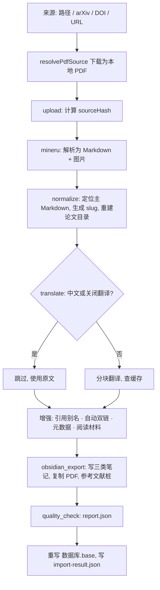

# PDF 导入流水线：从 PDF 到 Obsidian 笔记

状态：现状说明。English: [PDF Import Pipeline](../../en/topics/pdf-import-pipeline.md)

本文按代码实际执行顺序说明一篇 PDF 从输入到写入 Vault 的完整过程，以及每一步的缓存、对 Vault 的写入和已知风险。对应代码：`packages/pipeline/src/import-pdf.ts`（流水线主体）、`packages/pipeline/src/resolve-pdf-source.ts`（来源解析）、`packages/core/src/**`（各步骤实现）。概览见[系统设计 §4](../system-design.md#4-导入流水线packagespipeline)。

---

## 1. 来源解析

`resolvePdfSource(input, outputDir, baseDir?)` 判断输入类型：

- 以 `http(s)://` 开头、形如 `arXiv:2401.12345` / `2401.12345`、或以 `10.xxxx/` 开头的视为远程来源，下载到 `outputDir`；其余按本地文件处理。
- arXiv ID 下载 `arxiv.org` 的 PDF；DOI 经 `doi.org` 解析；URL 直接下载。
- 本地相对路径按调用方给的 `baseDir` 解析（命令行传执行目录）。调用方须传原始输入，先判断类型再解析路径。
- 命令行下载到配置文件旁的 `.pipeline/downloads/`，Web 下载到 `.pipeline/desktop-web/downloads/` 后移入上传目录。

## 2. upload

确认路径是文件，计算 SHA-256 得到 `sourceHash`。由此生成：

- `runId` = 文件名 slug 前 15 个字符 + `-` + 哈希前 16 个字符；解析目录为 `<mineru.outputDir>/<runId>/`。
- 命令行任务的 `taskId` 与任务复用也基于该哈希（见[系统设计 §5](../system-design.md#5-任务管理packagestasks命令行)）。

## 3. mineru

1. 把 PDF 复制为 `<解析目录>/document.pdf`（避免文件名中的特殊字符影响 MinerU），解析结束后删除副本。
2. 按 `mineru.mode` 调用官方 API、HTTP 服务或本地命令（[系统设计 §4.2](../system-design.md#42-mineru-运行模式)）。
3. 官方 API 结果是 zip，下载后解压到解析目录。

缓存：解析目录本身。续跑时如果 `mineru` 已完成就不再调用 MinerU，直接读已有产物。修改 `runId` 的组成会让所有论文重新解析。

## 4. normalize

1. `findPrimaryMarkdown` 在解析目录中找到主 Markdown（优先名为 `document` 的文件）。
2. 取首个标题作为原文标题（没有则用文件名），`toSlug` 生成基础 slug。`resolveUniqueSlug` 读取 `<documentDir>/<基础 slug>/<基础 slug>.index.md` 的 `sourceHash`：目录不存在、没有索引页或哈希相同时用基础 slug；属于另一篇论文时用 `<基础 slug>-<哈希前 8 位>`。
3. 论文目录 `documentRoot` = `<vault.path>/<vault.documentDir>/<slug>/`。**先整体删除该目录**，再新建，并把 MinerU 的 `images/` 复制为 `<documentRoot>/<imageDirName>/`。
4. `rewriteMarkdownAssetLinks` 把 Markdown 中的图片链接改为 Vault 内路径。

续跑时跳过删除与复制，但仍会重新读取主 Markdown、计算 slug（后续步骤需要）。

风险：重新导入同一篇论文会删除论文目录内用户自己添加的文件。

## 5. translate

1. `detectMarkdownLanguage` 去掉 frontmatter、代码、链接、URL、数字与标点后统计汉字与拉丁字母：汉字 ≥ 120 且占比足够时判为 `zh-CN`；拉丁字母 ≥ 120 且汉字占比 < 8% 时判为 `en`；否则 `unknown`。
2. `zh-CN` 或 `translation.enabled: false` 时跳过翻译，译文笔记使用原文。
3. 否则 `translateMarkdownInChunks`：
   - `chunkMarkdown` 先按标题切出语义段（保留标题路径），再拆超长段、合并小块，每块不超过 `chunkCharLimit`。
   - 每块缓存键 = sha256(provider、preset、baseUrl、model、systemPrompt、块内容)，缓存文件 `<translation.cacheDir>/<键>.md`。
   - 未命中时发送：系统提示词 + 用户消息（文档标题、当前章节路径、块序号、翻译要求、块内容）；失败按 `maxRetries` 重试，间隔 1 s、2 s ……
   - 各块译文以空行拼接。
4. 续跑时如果 `translate` 已完成，从已有 `<slug>.zh.md` 去掉 frontmatter 后作为译文。

缓存：换模型、服务地址或提示词都会让全部块重新翻译；改分块规则或用户消息格式同样如此（后者不在缓存键中，但会改变译文——改动时应考虑是否清缓存）。

## 6. 阶段之间的增强步骤

以下步骤不是命名阶段，每次运行（包括续跑）都会执行：

| 步骤 | 做什么 | 关键配置 |
| --- | --- | --- |
| 引用别名发现 | 从原文 + 译文和 Vault 已有笔记中发现可链接的别名，数量写入索引页 | `obsidian.autoLink` |
| 自动双链 | 扫描 Vault（`scanDirs`，排除 `excludeDirs`）收集标题与别名，在译文中替换为 `[[目标\|原文字]]`；跳过 frontmatter、代码块、标题、已有链接与图片；当前论文自身的笔记与阅读材料不作为目标；每篇最多 `maxLinksPerNote` 个 | `minAliasLength`、`maxLinksPerNote` |
| 元数据 | 正文抽取 → CrossRef / OpenAlex 依次补空缺（单个来源失败只记警告；标题相似度过低视为误命中并缓存空结果）→ 本地期刊指标库 → EasyScholar → 按 slug 或 PDF 文件名应用 `overrides` | `metadata.*` |
| 阅读材料 | 原文与译文各取 `maxSourceChars` 的一半（超出取头尾），用阅读材料提示词分别生成摘要、术语表、问答；补 frontmatter 与指回索引页的链接，直接写入论文目录 | `readingAssets.*` |

阅读材料缓存键 = sha256(AI 服务四项、`readingAssets.systemPrompt`、`sourceHash`、材料类型、材料提示词)。内容缺少索引链接占位符等质量问题记为警告；某份材料的模型调用重试用尽仍失败时，跳过该份（不写文件、索引页不放链接），失败原因作为警告写入质量报告，导入继续。

## 7. obsidian_export

1. 生成三类笔记，均带 frontmatter（论文元数据、`lang`、`sourceHash`、互链、`createdAt`、翻译服务与模型、`translationSkipped`）：
   - `<slug>.original.md`：原文 Markdown（链接已改写）。
   - `<slug>.zh.md`：自动双链后的译文。
   - `<slug>.index.md`：标题、原文 / 译文 / PDF / 阅读材料链接、语言检测结果、元信息列表、自动关联列表；`type: index`。
2. 复制原 PDF 到论文目录。
3. `extractStructuredReferences` 从原文 + 译文中识别编号参考文献（`[1]`、`1.`、`1)` 等），提取标题、作者、年份、DOI、arXiv ID、期刊；`createReferenceStubs` 在 `<vault>/<documentDir>/` 下为 Vault 中尚无同名笔记的条目创建桩笔记，已有的跳过。

## 8. quality_check 与收尾

1. `createQualityReport` 比较原文与译文的标题数、图片数，检查图片文件是否存在、frontmatter 是否有效，汇总元数据与阅读材料警告，写 `<documentRoot>/<quality.reportFileName>`。有警告时 `status: needs_review`，结论与警告数写入返回结果的 `qualityStatus` / `qualityWarningCount`（续跑跳过本阶段时从已有报告读取）。
2. 所有阶段结束后（不受续跑影响）`exportObsidianDatabase` 重写 `<documentDir>/<database.fileName>`，筛选 `type == "index"` 且位于 `documentDir` 的笔记，列出名称、标题、作者、年份、期刊、引用数、影响因子、JCR、中科院分区、DOI、APA 与 BibTeX 引用。
3. 在解析目录写 `import-result.json`（`sourceHash`、`slug`、`databaseNotePath`），返回 `ImportPdfResult`。

## 9. 续跑行为汇总

| 阶段 | 续跑时 |
| --- | --- |
| `upload` | 总是执行（重新计算哈希） |
| `mineru` | 已完成则跳过，读取已有解析目录 |
| `normalize` | 已完成则跳过删除与图片复制；slug 仍重新计算 |
| `translate` | 已完成则从已有 `*.zh.md` 恢复译文 |
| 增强步骤 | 总是执行，依赖各自缓存 |
| `obsidian_export` | 已完成则跳过写笔记与参考文献桩 |
| `quality_check` | 已完成则跳过 |
| Bases 与 `import-result.json` | 总是执行 |
